# Super Simple Software Factory

> So take it. Fork it, strip the parts you do not need, rename the agents, throw out half the workflows, and roll what is left into the factory your product actually needs. The specific chains in here matter far less than the shape: code owns the loop, agents own the phases, and every run leaves a trace you can go read.
>
> from [disler/super-simple-software-factory](https://github.com/disler/super-simple-software-factory#built-to-be-observed-customized-and-reused)

This fork is what came of doing that.

SSSF is a Claude Code skill that installs a software factory into a repo. The factory is a set of ADWs, AI developer workflows: short Python scripts that run coding agents and plain code checks in a fixed order. Python decides what runs next, what counts as done, and when to retry. Each agent works inside one phase and hands back a typed report. Every event lands in a SQLite trace while the run is still going.

<p align="center">
  
</p>

**Kept from upstream:** code owns the loop, agents own the phases, and every run leaves a trace. All 12 of upstream's workflows are still here, beside two new ones, tickets and trials.

**Changed or added:**

- agents on a Claude or ChatGPT subscription, with no API key;
- spend caps per call, run, repo and machine, and a stop before a usage window runs out;
- a branch and worktree per run, several runs at once, and trials that race two rosters on one request;
- the [operator session](docs/concepts.md#the-operator-session), the Claude Code session that launches and watches chains, in a container, and runs in an OpenShell, Vercel or E2B VM;
- rules each repo owns, enforced on every shell command an agent runs, and agentsh as an opt-in second guard on this machine ([where a run runs](docs/concepts.md#where-a-run-runs));
- a guard chain that reviews every change to that enforcement before it merges.

[docs/fork.md](docs/fork.md) lists each change and links its design.

## Quickstart

On a Claude subscription, in a repo with a clean tree and at least one commit, with [uv](https://docs.astral.sh/uv/), [just](https://github.com/casey/just) and Claude Code installed ([the versions tested](docs/guide/install.md#before-you-start)):

```bash
git clone https://github.com/g5paul/super-simple-software-factory ~/github/super-simple-software-factory
export SSSF_SOURCE=~/github/super-simple-software-factory/.claude/skills/sssf

mkdir -p .claude/skills && cp -r "$SSSF_SOURCE" .claude/skills/
uv run .claude/skills/sssf/scripts/install.py --coding-agent claude_code
cp .env.sample .env
git add -A && git commit -m "Install SSSF"

just demo        # two cheap read-only runs; both should end ✓ success
```

Then put your real test command in `adws/adw_modules/quality.py`. Until you do, every test phase passes. Restart Claude Code and ask it for work in plain words:

```
/sssf add a /health endpoint that returns the git sha, on its own branch
```

The session picks a chain, launches it, watches the trace, and reports the result and its cost. Nothing merges until you say so.

## Docs

| Page | For |
|---|---|
| [Install](docs/guide/install.md) | each sign-in path, the container, VMs, and updates |
| [Run](docs/guide/run.md) | every chain and feature, each shown with a real run |
| [Watch](docs/guide/watch.md) | the terminal recipes, the dashboard, and the trace in SQL |
| [Customize](docs/guide/customize.md) | your checks, prompts, roster, caps and rules |
| [Troubleshooting](docs/guide/troubleshooting.md) | what each stop and refusal means |
| [Concepts](docs/concepts.md) | how a run is built: the operator session, phases, agents, guards, where a run runs, gates, the trace |

[docs/README.md](docs/README.md) lists the rest, and keeps them apart from the pages about how this hub runs.

## Why code owns the loop

Hand one agent a whole feature and you can't say which step failed, "done" means the agent stopped talking, and a retry starts from nothing. Run it twice and you get two different results.

SSSF splits the work into phases, and code runs the order. A phase is one agent with one job, or one command. A gate checks each agent's report against the repo: did the files it names exist, does the diff match what it says it changed. A failed check goes back to the same agent session as a correction, which costs a turn rather than a restart.

Most of a build needs no agent at all. Your test command is known, so a code phase runs it in a second for nothing, and its failures go back to the builder. Agents are for the parts that need reading and deciding.

This earns its keep when the same workflow runs a hundred times. For a one-off change, prompt an agent and move on.

## Built to be observed, customized and reused

The shape matters more than the parts, so take this fork as upstream asked you to take it. The checks, prompts and roster are starters for your repo, and [customize.md](docs/guide/customize.md) says where each lives.

Some parts serve only this hub, and a fork can delete them: the guard chain that reviews changes to SSSF's own enforcement code, the project reports `adws/check_projects.py`, `adws/levers.py` and `adws/features.py` with their tests, the hub's recipes in `local.just`, [docs/projects.md](docs/projects.md), [docs/sssf.md](docs/sssf.md), and [docs/open.md](docs/open.md). [customize.md](docs/guide/customize.md#strip-what-you-dont-need) lists the files. The hub's own `adws/adw_sssf_config/repo.yaml` sets `local_guard: agentsh`, which needs an agentsh build that isn't published yet, so set it to `text` in your fork. A repo you install SSSF into starts on `text`.

## Credit

SSSF is [disler's](https://github.com/disler/super-simple-software-factory) design, and this fork keeps its shape. He explains it in the video [Super Simple Software Factory](https://youtu.be/haUfb1ievTE), and teaches the patterns behind it in [Tactical Agentic Coding](https://agenticengineer.com/tactical-agentic-coding?y=sssf).

<p align="center">
  
</p>

## License

MIT, see [LICENSE](LICENSE).
