# How SSSF works

This page explains the parts every run is made of: ADWs, phases, agents, envelopes, gates, the trace, and the caps. You don't need it to run SSSF; the [guide](guide/) is enough for that. Read it when you want to change a chain, add a gate, or understand why a run stopped.

<p align="center">
  
</p>

## Code owns the loop

<p align="center">
  
</p>

Give one agent a whole task and you can't say which step failed. "Done" means the agent stopped talking, a retry starts cold, and the only record is a transcript. Run it twice and you get two different results.

SSSF puts the control in Python instead. An ADW (AI Developer Workflow) is a short script in `adws/` that runs a fixed list of phases. The script decides the order, the retries, and what counts as done. An agent does the work inside one phase and hands back a typed report. Code checks the report before the next phase starts.

A step whose command you already know stays code. Running `pytest` or `bun test` isn't a judgement call, so no agent spends a context window finding the test runner. When the suite fails, the failure goes back to the builder the same way an agent's report would.

## ADWs

The skill ships these chains, each in `adws/adw_<name>.py`:

| ADW | Phases | Use it when |
|---|---|---|
| `adw_prompt` | one agent, picked with `--agent` | you want one answer from one agent |
| `adw_scout` | scout | you want read-only recon, with nothing changed |
| `adw_plan` | planner | you want the spec before any code |
| `adw_build` | builder | the plan already exists |
| `adw_quality` | code only: `quality.py`'s checks | you want lint, format, typecheck and tests with no agent |
| `adw_plan_build` | planner, builder, commit | the work is small and well understood |
| `adw_build_test` | builder, tests, a bounded fix loop, commit in a worktree run | there's a suite to satisfy |
| `adw_build_review` | builder, reviewer, a bounded revise loop | "is this what was asked for" matters more than "does it run" |
| `adw_plan_build_test` | planner, builder, tests, fix loop, commit | the standard chain, `just sdlc` |
| `adw_plan_build_test_quality` | the same, plus every `quality.py` check | the repo has lint and typecheck worth enforcing |
| `adw_document` | a git diff, then documenter | you want a write-up of what shipped |
| `adw_simple_sdlc` | plan, build, verify, review, document, with three commits | the work is real and its shape isn't obvious |
| `adw_tickets` | scout, then for each ticket: build test-first, verify, commit; then two reviews and docs | the feature has a spec and tickets |
| `adw_trial` | one `adw_simple_sdlc` per roster, then a panel of referees | you want to compare rosters on one request |

Four more scripts manage runs rather than build anything: `adw_kill`, `adw_worktree` (merge, discard and rebase), `adw_sandbox_usage`, and `adw_guard_change`, which is this repo's own and not stamped.

`--adw-id` joins an existing run. The run keeps its folders, and each agent continues its own session instead of starting cold. That's how you chain two ADWs by hand:

```bash
uv run adws/adw_plan.py "add a /health endpoint"            # prints adw_id a1b2c3d4
uv run adws/adw_build_test.py "implement the plan" --adw-id a1b2c3d4
```

## Phases

<p align="center">
  
</p>

A run is a list of phases, and every phase uses the same context manager, whoever owns it:

```python
REQUIRED_AGENTS = ["planner", "builder"]   # names, never models

cfg = agents.load_config(config)
agents.validate(cfg, REQUIRED_AGENTS)      # a missing agent fails before anything starts
run = session.ensure(cfg, adw_id)

with run.phase(PhaseParams(name="plan", kind="agent", owner="planner",
                           description="Turn the request into an implementable plan")) as ph:
    plan = ph.call(AgentCall(output_type=PlanOutput, prompt=prompt, gates=gates.PLAN))

with run.phase(PhaseParams(name="commit", kind="code", owner="git",
                           description="Land the code only after the suite came back green")) as ph:
    message = build.commit_message or f"sssf({run.adw_id}): {build.summary}"
    ph.log(sha=git_helper.commit_all(message), message=message)

return run.finish(accepted=test.passed, reason="the suite stayed red")
```

A phase has one of three kinds:

- **engineer** is you: the request that starts the run.
- **agent** is `ph.call(...)`: a prompt goes in, a typed report comes out, and gates check it.
- **code** is a step that runs without a model, such as the tests, a commit, or a worktree's setup. It always gets its own phase, so the trace shows when code ran and when an agent did.

Each owner gets its own lane in the dashboard, so a plan-build-test run has five: you, git, the planner, the builder, and quality.

The commit phase shows the pattern. The builder proposes a commit message as a field of its report. Code decides whether to use it, falls back when it's empty, and makes the commit. The agent never runs `git commit` itself.

Every phase starts as `fail`. A clean exit makes it `success`, and an agent phase also needs its report to parse and every gate to pass. `run.finish(accepted=...)` asks a second question, since every phase can pass while the run still fails. A test phase that ran a red suite did its job, but the run shouldn't count as a success. One call sets the exit code, the session's status, and the banner, so they can't disagree.

## Agents

`adws/adw_sssf_config/sssf.config.yaml` is the roster. Each entry says who one agent is:

```yaml
defaults:
  coding_agent: claude_code        # claude_code | pi
  model: anthropic/claude-sonnet-5-5
  max_run_cost: 5.00               # dollars, checked before every agent call
  protected_files:                 # no agent may edit the machinery that grades it
    - adws/adw_modules/
    - adws/adw_sssf_config/
    - adws/adw_*.py

agents:
  - name: planner
    model: anthropic/claude-opus-5-5
    thinking: high
    purpose: Turn a request into a plan the builder can implement without asking questions.
    prompt_engineering:
      system: adws/adw_data/prompt_engineering/planner/system.md
      user: adws/adw_data/prompt_engineering/planner/user.md
    writes:                        # the plan is all it may leave in the repo
      - specs/
```

The starter rosters have eight agents:

| Agent | Job |
|---|---|
| `planner` | turns the request into a plan in `specs/` |
| `builder` | implements the plan, and fixes it when the tests fail |
| `ticket_builder` | builds one ticket, test-first, in `adw_tickets` |
| `scout` | read-only recon |
| `reviewer` | reviews a change against its request |
| `standards_reviewer` | reviews a ticket feature against the repo's standards |
| `spec_reviewer` | reviews a ticket feature against its spec |
| `documenter` | writes up what shipped |

A trial adds referees, one per model family in the trial, from `prompt_engineering/referee/`. There's no tester agent, because a suite is a known command, so code runs it.

An ADW names agents, never models. Swap a model in the roster and every chain picks it up.

**`tools` says what an agent can do. `writes` says where it may leave changes.** `bash` runs anything and `write` reaches any path, so SSSF can't stop an agent at the tool. Code compares the repo before and after every call instead. A change outside `writes` is rolled back and the phase fails. A read-only agent can still write its own report, which goes outside the repo.

Some commands do harm outside the repo, such as `git push` or a recipe that bills an API key. `agent_rules` in `adws/adw_sssf_config/repo.yaml` holds rules every agent gets in its prompt. A rule with `forbid` patterns is also enforced. SSSF reads each shell command as the agent sends it. A match stops the agent and the run, though the command may have started already. With `on_match: refuse`, the command is refused before it runs, and the run goes on. [customize.md](guide/customize.md#rules-for-every-agent) has examples.

Each Claude Code agent runs with `--safe-mode`, so it never loads your `CLAUDE.md`, skills, hooks or MCP servers. It sees its prompt and the repo.

## Envelopes

<p align="center">
  
</p>

An agent can hand work on in two ways: files it writes to the run's `context_handoff/` folder, and its final reply, which must be JSON. Code parses that reply against the output type the call names, saves it as `envelope.json`, and puts it in the next agent's prompt. Context moves between agents in code, never in a shared conversation.

```python
class EnvelopeBase(BaseModel):
    status: Literal["success", "fail"]
    summary: str = ""
    artifacts: list[str] = Field(default_factory=list)
    notes_for_next_agent: str = ""

class BuildOutput(EnvelopeBase):
    changed_files: list[str] = Field(default_factory=list)
    commit_message: str = ""        # the commit phase uses it
```

An output type lives in three places, which must match: the class in `data_types.py`, the JSON example in that agent's `user.md` under `## Report`, and `output_type=` at the call site. Change one and change the other two in the same edit.

## Gates

A gate checks what the report claims, after the agent finishes. Nobody knows ahead of time which files an agent will touch, so the gates compare its claims with the repo:

| Gate | It checks |
|---|---|
| `artifacts_exist` | every file the report lists exists |
| `files_non_empty` | none of them is empty |
| `json_parses` | listed JSON files parse |
| `diff_matches_claims` | `changed_files` matches what git sees changed |
| `plan_well_formed` | the plan's two copies match, no committed spec was overwritten, it has a verification heading, and it names a real file |
| `verdict_consistent` | a review's verdict agrees with its findings |
| `panel_complete` | a trial's referee judged every attempt and ranked each once |
| `tests_pass(command)` | the command exits 0 |

A gate is a function, `gate(envelope, run) -> GateReport`, with one check per item it looked at, so a green gate tells you what it checked.

When the reply doesn't parse, or a gate finds a problem, nothing restarts. SSSF sends the same session a correction that names what was wrong, and the agent keeps everything it had in context. A pi agent continues with the same `--session-id`, and a Claude Code agent with `--resume`. A correction costs one message; a restart would cost the whole context.

Gates can't judge plan quality or code taste. That's a reviewer's job, or yours.

## The trace

<p align="center">
  
</p>

Every event goes into `adws/adw_data/sssf.db` while the run is still going. `agent_cc.py` and `agent_pi.py` read the agent's output line by line, and the tracer inserts each event as it arrives, so you see tool calls mid-run.

The database has seven tables:

| Table | Holds |
|---|---|
| `sessions` | one row per run: request, status, tokens, cost |
| `phases` | each phase's kind, owner, status and attempt |
| `events` | everything that happened, in order |
| `envelopes` | each agent's parsed report |
| `gate_results` | each gate's checks |
| `agent_sessions` | one row per agent per run: its coding-agent session, model, and how full its context window is |
| `processes` | each run's live processes and pids, so `just kill` can stop them |

Every event carries its `adw_id` and `phase_id`, and `parent_id` nests an agent's tool calls under its phase. One `tool_call` row covers each call, named the way you'd read it, such as `bash: ls -la src`.

Readers poll one query:

```sql
select * from events where adw_id = ? and rowid > ? order by rowid limit 500;
```

The live view and the full history are the same query, run at different rates. That's why there's no ingest endpoint, no WebSocket and no replay path. The database runs in WAL mode, so a reader never blocks a run.

The files in `adws/adw_data/sessions/<adw_id>/` stay the raw record: `raw_output.jsonl`, `envelope.json`, `agent_map.json`. You can rebuild the database from them. [watch.md](guide/watch.md) shows how to read both.

## The caps

A run you aren't watching can spend more than you meant it to. These limits stop it:

| Cap | Where | It limits |
|---|---|---|
| `max_run_cost` | `defaults` in the roster, $5 by default | one run, checked before every agent call |
| `max_call_cost` | each agent in the roster | one Claude Code call, passed as `--max-budget-usd` |
| `max_live_cost` | `repo.yaml`, off by default | what all live runs in the repo spend together |
| `max_daily_cost` | `repo.yaml`, off by default | what the repo spent in the last 24 hours |
| `max_daily_cost` | `~/.config/sssf/limits.yaml`, off unless the file exists | what every repo on the machine spent in the last 24 hours |
| `rate_limit_stop` | `defaults` in the roster, 0.8 | how full Claude's 5-hour or 7-day window may be before an agent starts |
| `max_silence_minutes` | `repo.yaml`, 15 by default | how long an agent may write nothing before it and the run are stopped |

The dollar caps are checked before every agent call and when a run starts. Two runs that start at the same moment can each overshoot by one call. A run also stops when the Claude account moves onto usage credits, and a pi run stops by name when ChatGPT refuses a call at the plan's limit.

On a subscription, every cost SSSF shows is list price, what the tokens would cost on the API. You aren't charged it. The caps still limit how much of the plan's usage one run can take.

No cap retries, and none throws work away. If the tree holds uncommitted changes when a run stops, the message says how to look at them, keep them, or drop them.

## Branches and worktrees

A run works on your checked-out branch unless you pass `--worktree`. Then it gets its own branch, `sssf/<adw_id>`, cut from your branch's tip, in its own folder under `adws/adw_data/worktrees/`. You can keep working while it runs, and nothing reaches your branch until you run `just merge`. [run.md](guide/run.md#on-its-own-branch) has the commands.

`--sandbox vercel` and `--sandbox e2b` go one step further. The chain stays on your machine with the trace and the caps, while its agents, checks and git run in a VM made for the run and deleted at its end. Commits come back to the run's branch. The design is [remote-sandboxes.md](designs/remote-sandboxes.md).

## The skill

<p align="center">
  
</p>

Everything comes from `.claude/skills/sssf/`. `SKILL.md` holds the rules and sends each request to one of 13 cookbooks. `references/` holds the specs, `scripts/` the installer and generators, and `templates/` what gets stamped. The visualizer is in `apps/visualizer/`.

The installer copies the templates into your repo. From then on the copies are yours: edit them in your repo, never back inside the skill. `install.py --update` brings in the skill's later changes and keeps your edits. It's all Python, YAML and Markdown, with no framework to learn.
