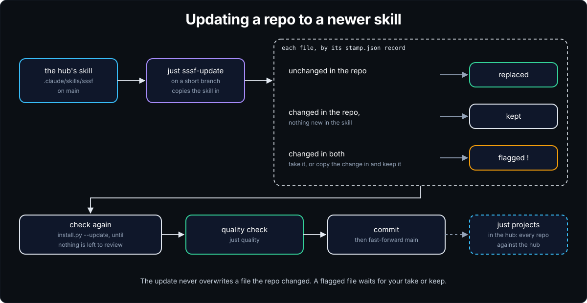

# Install SSSF in a repo

SSSF installs into the repo it will work on. You copy the skill in, run the installer, and check the result. First pick how the agents sign in, since the installer stamps a roster for one of these:

| Agents run on | Install flag | What you need | Keys in `.env` |
|---|---|---|---|
| a Claude subscription, through Claude Code | `--coding-agent claude_code` | Claude Code, signed in | none |
| a ChatGPT subscription, through pi | `--chatgpt` | pi, signed in to ChatGPT | none |
| API keys, through pi | none, the default | pi, and a key for each provider the roster names | one per provider |

The two subscriptions are cheaper to start with. There's no bill per token, and no key can bill the API by accident. You can [add a second roster](#add-another-roster) later and race the two with a trial.

For a guided first install and run on a Claude subscription, follow [Your first run](first-run.md).

## Before you start

The last column is the version on the machine where SSSF is built and tested, a WSL2 Ubuntu 24.04 install, checked on 2026-11-09. Other versions may work, but these are the ones known to.

| Tool | Why | Check | Tested |
|---|---|---|---|
| [uv](https://docs.astral.sh/uv/) | runs every ADW | `uv --version` | 0.10.3 |
| git 2.32 or later | branches, worktrees, commits | `git --version` | 2.43.0 |
| sqlite3 | reading the trace by hand | `sqlite3 --version` | 3.45.1 |
| python3 | the billing check below, and `container/run.sh` | `python3 --version` | 3.12.3 |
| rsync | `just sssf-update` | `rsync --version` | 3.2.7 |
| [just](https://github.com/casey/just) | the recipes in this guide. Without it, run the line each recipe wraps | `just --version` | 1.59.0 |
| [Claude Code](https://docs.claude.com/en/docs/claude-code) | the [operator session](../concepts.md#the-operator-session), and the agents on a Claude roster | `claude --version`, then `claude auth status` | 2.1.321 |
| [pi](https://github.com/earendil-works/pi) | the agents on a ChatGPT or API-key roster | `pi --version` | 1.4.0 |
| Node.js 22 or later | pi | `node --version` | 24.11.1 |
| [gitleaks](https://github.com/gitleaks/gitleaks) 8.30.1 or later | the secret scan before each push, once you turn it on | `gitleaks version` | 8.30.1 |
| [bun](https://bun.sh) | the dashboard | `bun --version` | 1.4.4 |
| [Podman](https://podman.io), rootless, with pasta | only for the operator container and `--sandbox openshell` | `podman --version` | 4.9.3, passt 2024-02-20 |
| [Codex CLI](https://github.com/openai/codex) | only for the [ChatGPT usage meters](watch.md#chatgpts-windows-through-codex-cli) on the dashboard | `codex --version` | 0.153.0 |
| [NVIDIA OpenShell](https://github.com/NVIDIA/OpenShell) | only for `--sandbox openshell` | `openshell --version` | 0.1.7 |
| [agentsh](https://github.com/canyonroad/agentsh) | only for [`local_guard: agentsh`](../concepts.md#agentsh-on-top-of-the-base-guards) | `agentsh --version` | `0.20.6-dev.fork+05b3777f`, a build of the hub's patched fork. SSSF accepts no other, and the fork's patches aren't published yet |

Each kind of run last passed on these dates:

| Kind of run | Last passed |
|---|---|
| Claude Code agents on this machine, under `local_guard: text` and `local_guard: agentsh` | 2026-11-09 |
| the operator container | 2026-11-05 |
| Vercel and E2B | 2026-11-05 |
| OpenShell | 2026-11-08 |

A run before 2026-11-09 may have used an older version of a tool above.

SSSF pins some of what it pulls in itself:

| What | Version | Where it's set |
|---|---|---|
| pi in the container image | 1.4.0 | `PI_VERSION` in `container/Containerfile` |
| The container's base image | Ubuntu 22.04. uv, just and Claude Code are the latest when the image is built | `container/Containerfile` |
| The E2B SDK | `e2b==2.62.0` | `sandbox_e2b.py`, `scripts/e2b_template.py` |
| The Vercel Sandbox SDK | `vercel-sandbox==0.10.0` | `sandbox_vercel.py` |
| The dashboard's packages | the versions in `bun.lock` | `apps/visualizer/` |
| [Matt Pocock's skills](https://github.com/mattpocock/skills), for [tickets](run.md#a-feature-from-tickets) | commit `a496f55`, 2026-10-29 | the passages copied into the ticket agents' prompts name it |
| The agentsh build | sha256 `603dbf14…f1747`, commit `05b3777f` on the fork | `PINNED_SHA256` in `agentsh_guard.py` |

The ADWs' own Python libraries, pydantic, python-dotenv, pyyaml and rich, aren't pinned. Each time, uv takes the latest. On 2026-11-09 those were 2.14.3, 1.2.4, 6.0.3 and 15.0.0.

The repo needs at least one commit, because worktree runs and ADWs that end in a commit phase start from it. In a new folder, run `git init && git commit --allow-empty -m init` first. Don't run it in a repo that already has commits.

## 1. Copy the skill in

From the root of the target repo, run:

```bash
mkdir -p .claude/skills
cp -r ~/github/super-simple-software-factory/.claude/skills/sssf .claude/skills/
```

Use the path of your own clone of super-simple-software-factory. Whenever you run the installer, set `SSSF_SOURCE` to the same skill folder, so the installer records which commit you installed. Without it, the installer prints `skill: unknown (no git source)` and `stamp.json` has no `skill` key.

## 2. Run the installer

Run one of the three blocks below from the repo root. Everything lands in the current folder. The installer prints what it stamped, and the line that turns on the secret scan.

### Claude subscription

```bash
export SSSF_SOURCE=~/github/super-simple-software-factory/.claude/skills/sssf
uv run .claude/skills/sssf/scripts/install.py --coding-agent claude_code
cp .env.sample .env
```

Leave every key in `.env` empty. Claude Code agents use the account `claude` is signed in to, and SSSF keeps `ANTHROPIC_API_KEY` away from them.

### ChatGPT subscription

Sign pi in to ChatGPT once. Run `pi`, type `/login`, and pick `openai`. Then run:

```bash
export SSSF_SOURCE=~/github/super-simple-software-factory/.claude/skills/sssf
uv run .claude/skills/sssf/scripts/install.py --chatgpt
cp .env.sample .env
echo "SSSF_PI_AUTH=subscription" >> .env
```

`SSSF_PI_AUTH=subscription` keeps `OPENAI_API_KEY` and `ANTHROPIC_API_KEY` away from pi agents, so a lapsed sign-in fails the run instead of billing a key.

### API keys

```bash
export SSSF_SOURCE=~/github/super-simple-software-factory/.claude/skills/sssf
uv run .claude/skills/sssf/scripts/install.py
cp .env.sample .env
```

The starter pi roster names three providers, so it needs three keys in `.env`:

| Model | Agents | Key |
|---|---|---|
| `google/gemini-3.6-flash`, through OpenRouter | the default: builder, scout and the rest | `OPENROUTER_API_KEY` |
| `fireworks/accounts/fireworks/models/kimi-k3` | planner | `FIREWORKS_API_KEY` |
| `openai/gpt-5.6-terra`, `openai/gpt-5.6-luna` | reviewers, documenter | `OPENAI_API_KEY` |

To use one key instead of three, delete the agents' own `model:` lines in `adws/adw_sssf_config/sssf.config.yaml`. Every agent then uses `defaults.model`.

At launch, each ADW checks that every model it uses is in `pi --list-models`. pi lists a provider's models only once that provider has a key. So if an agent lacks its key, the run stops before any agent runs, with `model pattern ... not found in pi --list-models`. `just demo` uses only the scout, so it can pass while `just sdlc` stops. A key that's set but wrong fails later, when its agent runs.

### A repo with its own justfile

The installer leaves an existing justfile alone. Add `mod sssf 'sssf.just'` to it, then run the installer again. The installer stamps SSSF's recipes as `sssf.just`, and they run as `just sssf demo`, `just sssf sessions` and so on. If you add the line before the first install, one run is enough. Wherever the guides say `just <recipe>`, read `just sssf <recipe>`.

## 3. Restart Claude Code and commit

Claude Code registers `/sssf` when a session starts. Restart any session that was open in the repo before the install. `claude --continue` keeps the conversation.

Commit the install on its own, from a tree that was clean before you started. Worktree runs cut their branch from your last commit, and VM runs clone it, so an uncommitted install isn't in them.

```bash
git add -A && git commit -m "Install SSSF"
```

## 4. Check that it works

```bash
just demo        # two cheap read-only runs, end to end
just sessions    # the runs it just made
```

Both runs should end `✓ success`. That means the roster loaded, an agent ran and signed in, its report parsed, and the events reached `adws/adw_data/sssf.db`. Every larger ADW uses the same path, so fix a failure here first. [Install and sign-in](troubleshooting.md#install-and-sign-in) covers the usual ones.

Then check the sign-in for your roster:

- **Claude.** `just login-check` should print `login ok: Claude Code agents can sign in`. To confirm no agent billed the API, check that every agent's init event says `apiKeySource` is `none`:

  ```bash
  grep -h '"subtype":"init"' adws/adw_data/sessions/*/*/raw_output.jsonl \
    | python3 -c "import json,sys; print({json.loads(l)['apiKeySource'] for l in sys.stdin})"
  ```

  It should print `{'none'}`.
- **ChatGPT.** `pi auth check --provider openai --json` should report `"authType": "oauth"`.
- **API keys.** `pi --list-models` should list each model the roster names.

## 5. Wire in your own checks

The stamped `adws/adw_modules/quality.py` holds placeholder commands that exit 0. Until you replace them, a test phase passes whatever the builder did. Put in the commands your CI runs, such as tests, lint, format, typecheck and build. [Your checks](customize.md#your-checks) shows how.

Then keep SSSF's files out of your repo's own tools. A repo-wide `ruff check .`, eslint or tsc also reads the files SSSF stamped in `adws/` and `.claude/`, and CI fails on them. Exclude `adws/`, `.claude/`, `specs/` and `app_docs/`. If you stamped the operator container, exclude `container/` too.

| Tool | Setting |
|---|---|
| ruff | `[tool.ruff]` `extend-exclude = ["adws", ".claude", "specs", "app_docs"]` in `pyproject.toml` |
| eslint | `{ ignores: ["adws/**", ".claude/**", "specs/**", "app_docs/**"] }` in `eslint.config.js` |
| prettier, biome | `.prettierignore`, or `files.ignore` in `biome.json` |
| tsc | `"exclude": ["adws", ".claude"]` in `tsconfig.json` |
| a Python sdist | `exclude = ["/adws", "/.claude", "/.githooks"]` for hatchling, or `prune` lines in `MANIFEST.in` |

The skill's [post-install checklist](../../.claude/skills/sssf/cookbooks/install.md#post-install-checklist) has the rest: worktree setup, spend caps for the repo, and what to set for a private repo.

## 6. Turn on the secret scan

The installer stamps `.githooks/pre-push`. The hook scans each push for secrets with gitleaks and refuses the push if it finds one. It also refuses any push from an SSSF agent. Git runs the hook only after you turn it on, once per clone:

```bash
git config core.hooksPath .githooks
```

The setting stops git reading `.git/hooks`, so first move any hook you keep there into `.githooks/`. [Secret scan before every push](../secret-scan.md) explains the hook and how to test it without a real push.

## Add another roster

To race two rosters with a trial, stamp the second beside the first. For the ChatGPT roster on a Claude install, run:

```bash
uv run .claude/skills/sssf/scripts/install.py --add-roster chatgpt
echo "SSSF_PI_AUTH=subscription" >> .env
git add adws/adw_sssf_config/sssf.config.chatgpt.yaml && git commit -m "Add the ChatGPT roster"
```

If pi isn't signed in to ChatGPT, run `pi`, type `/login`, and pick `openai`. A trial refuses a ChatGPT roster unless pi reports an OAuth sign-in and `SSSF_PI_AUTH=subscription` is set. Commit the roster, since `just merge` and `just sssf-update` refuse on a dirty tree.

The roster lands as `adws/adw_sssf_config/sssf.config.chatgpt.yaml`. `just rosters` lists every roster and the model each agent runs. To use a roster for one run, set `SSSF_CONFIG` in front of any recipe:

```bash
SSSF_CONFIG=adws/adw_sssf_config/sssf.config.chatgpt.yaml just sdlc "add a /health endpoint"
```

## Run the operator session in a container

On the host, Claude Code asks you to approve each launch. The operator container runs the operator session with `--dangerously-skip-permissions` instead. Inside the container, the session can reach only the repo and `~/.config/sssf`, so it can launch ADWs without asking.

The container needs rootless Podman with pasta installed. `run.sh` asks for pasta itself, so Podman 4 works. The machine SSSF is tested on runs 4.9.3.

1. Stamp the container. At install, add `--container` to your sign-in flag, for example `install.py --coding-agent claude_code --container`. On its own, `--container` stamps the default pi roster. In a repo that's already installed, run it alone:

   ```bash
   uv run .claude/skills/sssf/scripts/install.py --container
   ```

2. Make a token once. Every repo shares it, and it lasts about a year. `claude setup-token` opens a browser sign-in and prints a token that starts `sk-ant-oat`. Save the token without echoing it:

   ```bash
   mkdir -p ~/.config/sssf-container && chmod 700 ~/.config/sssf-container
   read -rs -p "Paste token, then Enter: " T && printf 'CLAUDE_CODE_OAUTH_TOKEN=%s\n' "$T" > ~/.config/sssf-container/token.env && unset T && chmod 600 ~/.config/sssf-container/token.env
   ```

   Keep the token out of the repo and out of chat. It signs in to your subscription.
3. Start a session from a login shell, in a terminal of its own:

   ```bash
   just container      # runs container/run.sh; add -p '<request>' for one headless request
   ```

   The first start builds the image. A pi roster also needs the host signed in to pi. The host keeps the sign-in, and a broker hands each pi agent a one-hour token.
4. Check that the session's shells get the token. Inside the session, `! printenv | grep -c '^CLAUDE_CODE_OAUTH_TOKEN='` must print `1`.

A container session can't push, since neither `~/.ssh` nor your git config is mounted. Add the tools your checks need, such as bun, to `container/Containerfile`. [In the container](run.md#in-the-container) shows an example run.

## Set up remote VMs

For a free OpenShell microVM on the host instead, run `just openshell-setup`. It needs no API key. [In a VM](run.md#in-a-vm) covers it.

`--sandbox vercel` and `--sandbox e2b` run a run's agents, checks and git in a VM made for the run. Set up the provider you'll use:

1. For Claude Code agents in the VM, save a Claude token in `~/.config/sssf-sandbox/token.env`. Make it the same way as the container's, as `CLAUDE_CODE_OAUTH_TOKEN=<token>`. A pi agent on `openai/` models needs only the host's pi sign-in. SSSF hands each call a short-lived token, and the sign-in stays on the host.
2. Put the provider's keys in the repo's `.env`:

   | Provider | Keys |
   |---|---|
   | Vercel Sandbox | `VERCEL_TOKEN`, `VERCEL_TEAM_ID`, `VERCEL_PROJECT_ID` |
   | E2B | `E2B_API_KEY` |

3. If you use E2B, build SSSF's VM template once per E2B team, from a repo whose `.env` has the key:

   ```bash
   just e2b-template
   ```

A Vercel or E2B run uploads the repo's code to that provider. An OpenShell run keeps the code on the host. Keep a private repo on `sandbox: none`, the default, or `sandbox: openshell` in `adws/adw_sssf_config/repo.yaml`, and use a remote VM only when you mean to. `just sandbox-usage` shows what VM runs used of each provider's free allowance. [In a VM](run.md#in-a-vm) shows an example run.

## Turn on agentsh, optional

Every repo starts on `local_guard: text`, which means SSSF's base guards alone. `local_guard: agentsh` adds agentsh around them for runs on the host. Each agent runs under agentsh, which refuses files, commands and hosts at the system call, and the base guards keep running. [agentsh, on top of the base guards](../concepts.md#agentsh-on-top-of-the-base-guards) says what the base guards and agentsh each cover, and where agentsh is untested. Leave agentsh off unless the repo fits the case that section describes.

agentsh needs its service, installed as root, with the one build SSSF pins. That build comes from the hub's fork of agentsh, whose patches aren't published yet, so for now agentsh works only where that build is installed.

Once the service is installed, do these steps once per repo. Do them again whenever `secret_files`, `deny_exec` or `network_allow` change.

1. Set `local_guard: agentsh` in `adws/adw_sssf_config/repo.yaml`, and leave `sandbox` at `none`.
2. From the repo, run the installer from a clean checkout of the SSSF hub at the repo's skill version:

   ```bash
   just agentsh-install                 # the hub is found from SSSF_SOURCE in .env
   just agentsh-install ~/path/to/hub   # or named
   ```

   The recipe runs the hub's `scripts/agentsh_install.py` for this repo's main checkout. It writes the repo's policy, shows a diff against what's in `/etc/agentsh/`, and then prints `sudo` lines. It never runs `sudo` itself.
3. Read the diff.
4. Stop every agent.
5. Run the printed lines yourself. They end with `sudo systemctl restart agentsh`. Run it after every install, "Nothing to install" included. A run refuses while the service started before its binary or config last changed. If the first run after a restart still refuses for that reason, restart once more: the check counts whole seconds.

Before it starts, a run checks the service, the build and the installed policy, and that the service was restarted since. If one is wrong, the run refuses with a message naming the fix. The [config reference](../../.claude/skills/sssf/references/config.md) has the full list of checks and known limits.

## Update to a newer skill

When the hub's skill changes, bring an installed repo up to date:

<p align="center">
  
</p>

```bash
echo "SSSF_SOURCE=$HOME/github/super-simple-software-factory/.claude/skills/sssf" >> .env   # once
just sssf-update
```

`just sssf-update` copies the skill in and runs `install.py --update`:

- A file you never changed is replaced.
- A file you changed, such as `quality.py`, is kept and listed.
- A file you changed that the skill also changed is flagged for review with a `diff` command. Settle each one with `just take <path>`, which takes the skill's version, or `just keep <path>`, which keeps yours.

Then commit the update on its own, and run `just quality "check after the SSSF update"`.

`just sssf-update` refuses while the tree has uncommitted changes or an ADW is running. It also refuses when the skill source is on a branch with commits that aren't on its `main`. [The install cookbook](../../.claude/skills/sssf/cookbooks/install.md#update-an-installed-repo) has the details.

In a repo that loads SSSF as a module, run `just sssf sssf-update`.

Don't use `--force` to update. It overwrites every stamped file, your roster, prompts and `quality.py` included.
