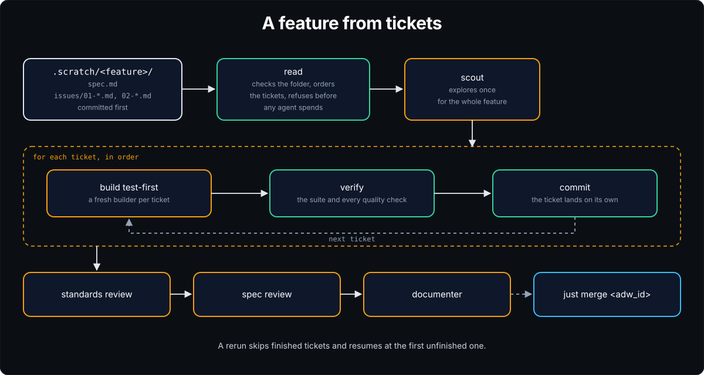
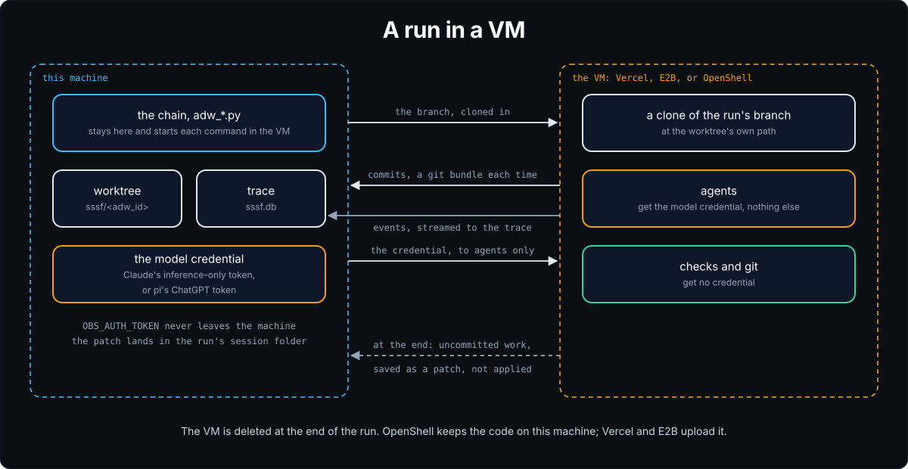

# Run SSSF

Every example on this page is a real run in [sssf-sandbox](../projects.md), a small Python text library. The first ran on 2026-11-09 on skill 7b36e01, and the rest on 2026-11-05 on skill 7decd41. Output is trimmed to the lines that matter, and long lines are cut short. Costs are list price. On a subscription you aren't charged them.

There are two ways to start a run. One is to ask the [operator session](../concepts.md#the-operator-session), the Claude Code session in your repo, in plain words starting with `/sssf`. It picks an ADW, the AI developer workflow that fits the request, writes its prompt, launches it and reports back. The other is to run the `just` recipe yourself. Each section shows the request both ways.

## Ask in Claude Code

Start here. In Claude Code, in the repo:

```
/sssf add textkit.is_palindrome(text), which says whether a text reads the same backwards once case, spaces and punctuation are ignored, so "A man, a plan, a canal: Panama" gives True. Export it and test it. Run it on its own branch, then tell me the adw_id, status, cost and commits.
```

On the host, Claude Code asks you to approve the launch. The session picked `adw_simple_sdlc` with `--worktree`, wrote the ADW's prompt with what's in and out of scope, and followed the trace while the run went. Its report, trimmed:

```
Run b5b5d40a succeeded: all 11 phases passed and it cost $0.6292 (539,140 tokens).
The work is on branch sssf/b5b5d40a, and nothing is on agentsh-rollout yet.

Commits:
- 3014011 Add spec for exporting is_palindrome from textkit
- 058292e Export is_palindrome from textkit with tests and docs
- ece5bf2 Document the is_palindrome package export

One surprise. is_palindrome already existed in textkit/palindrome.py, but textkit
didn't export it. So the run didn't write a new function. It added the export,
a module docstring, and tests that cover the Panama case.

What the checks proved. Only `uv run pytest -q` actually ran, and it passed.
Lint, format, typecheck and build are still placeholder echoes in quality.py.

`just merge b5b5d40a` lands the branch on agentsh-rollout, and `just discard
b5b5d40a` drops it. I'll merge only when you tell me to.
```

The run took 2 minutes 22 seconds, under `local_guard: agentsh`. To land it, say "merge it" in the same session, or merge it yourself:

```console
$ just merge b5b5d40a
merged sssf/b5b5d40a into agentsh-rollout (fast-forward), now at ece5bf2; removed its worktree and branch
```

Without the session, the same request is `just simple-sdlc "<request>" --worktree`. You then write the prompt yourself, and read the trace with `just phases <adw_id>` or the [dashboard](watch.md).

## Pick an ADW

The session picks an ADW from what you ask for, or you can name one. To run it yourself, use the recipe.

| You want | Ask in Claude Code | Or run |
|---|---|---|
| one answer from one agent | `/sssf ask the scout to summarize this repo` | `just prompt "summarize this repo" --agent scout` |
| read-only recon | `/sssf find where auth is handled, change nothing` | `just scout "where is auth handled"` |
| a plan, no code | `/sssf plan a /health endpoint, don't build it` | `just plan "add a /health endpoint"` |
| plan, build, commit, no tests | `/sssf add a /health endpoint with the plan-build chain` | `just plan-build "..."` |
| plan, build, test, commit | `/sssf add a /health endpoint with the plan-build-test chain` | `just sdlc "..."` |
| the same, plus every quality check, a review and docs | `/sssf add a /health endpoint` | `just simple-sdlc "..."` |
| a feature with a spec and tickets | `/sssf build the case-convert tickets` | `just tickets .scratch/<feature>/` |
| two rosters on one request | `/sssf race main and chatgpt on adding a /health endpoint` | `just trial "..." main chatgpt` |

To make it a worktree run, add "on its own branch" to the request, or `--worktree` to the recipe. A prompt can be a string or a path to a Markdown file.

For a bug fix, a rename, or a change that follows an existing pattern, use `just simple-sdlc`. For a new mode, a new file format, or work that splits into slices you can check one at a time, use tickets. [choose_a_flow.md](../../.claude/skills/sssf/cookbooks/choose_a_flow.md) has the two questions that decide it.

## A plain build

In Claude Code: `/sssf add textkit.snake_case(text) with the plan-build-test chain`. Or:

```console
$ just sdlc "Add textkit.snake_case(text), which lowercases the text and joins its words with underscores, so 'Hello World' becomes 'hello_world'. Export it from textkit and test it."
adw_id: d36de4d2   engineer George Paul
▶ 01 request  engineer · George Paul  Capture the incoming ask
▶ 02 plan  agent · planner  Turn the request into an implementable plan
  ▸ planner anthropic/claude-opus-5-5
  ✓ gate artifacts_exist 2 checked
  ✓ gate files_non_empty 2 checked
  ✓ gate plan_well_formed 4 checked
  ✓ plan 40.6s
▶ 03 build  agent · builder  Implement the plan exactly
  ✓ build 12.9s
▶ 04 test_1  code · quality  Run the suite
  ✓ test_1 0.2s
▶ 05 commit  code · git  Land the code only after the suite came back green
  · sha: b0b2638, message: Add textkit.snake_case helper
│  status   ✓ success
│  cost     $0.3687
│  next     just phases d36de4d2
```

This ran on the default Claude roster. The run worked on the checked-out branch and committed there. If the suite had failed, the builder would have got the failures and up to two tries to fix them, each rechecked by the suite. Without a green suite, the run fails and makes no commit.

Next, run `git show` to read the change, or `just phases d36de4d2` for each phase's status.

## On its own branch

Add `--worktree`, or "on its own branch" when you ask in Claude Code, and the run becomes a worktree run, with its own branch and folder. You can keep working in your checkout while it runs.

```console
$ SSSF_CONFIG=adws/adw_sssf_config/sssf.config.chatgpt.yaml just sdlc "Add textkit.kebab_case(text), ..." --worktree
  · working in adws/adw_data/worktrees/8b8c596c on sssf/8b8c596c, from master at b0b2638; `just merge 8b8c596c` lands it
▶ 01 setup  code · worktree  Run repo.yaml's worktree_setup in the new worktree
...
│  status   ✓ success
│  cost     $0.0840

$ just merge 8b8c596c
merged sssf/8b8c596c into master (fast-forward), now at 085a13e; removed its worktree and branch
```

`SSSF_CONFIG` ran this one on the ChatGPT roster. `just merge` lands a successful run. It fast-forwards when it can, and makes a merge commit when your branch has moved on. It never rebases and never pushes.

`just merge` refuses, and changes nothing, unless all of these hold:

- the run succeeded;
- you have its launch branch checked out;
- your checkout is clean;
- the run's worktree holds nothing uncommitted.

In this run, a stray file in the worktree stopped the merge:

```console
$ just merge c95d4481
merge c95d4481: run c95d4481's worktree (adws/adw_data/worktrees/c95d4481) has uncommitted changes: STRAY.txt. The merge takes only sssf/c95d4481's commits and then removes the worktree, so they'd be lost. Commit them there (`git -C adws/adw_data/worktrees/c95d4481 add -A && git -C adws/adw_data/worktrees/c95d4481 commit`) and merge again, or `just discard c95d4481` to drop the run.
```

The other recipes for a worktree run:

```bash
just discard <adw_id>    # drop the branch and folder, whatever state they're in
just rebase <adw_id>     # for a repo that only takes fast-forwards: move the branch onto yours, then recheck
```

`--worktree` works with `adw_build_test`, `adw_plan_build_test`, `adw_plan_build_test_quality`, `adw_simple_sdlc` and `adw_tickets`. A worktree is a fresh checkout without your untracked dependencies, such as `node_modules`. List the commands that install them under `worktree_setup` in `repo.yaml`. They run before the first agent.

## Two runs at once

Worktree runs can go side by side, up to `max_worktree_runs` in `repo.yaml`, 2 by default. Each is its own launch, and you merge each on its own. In Claude Code, ask for both in one message, each on its own branch, and the session launches them together.

```console
$ export SSSF_CONFIG=adws/adw_sssf_config/sssf.config.chatgpt.yaml
$ just sdlc "Add textkit.kebab_case(text), ..." --worktree &
$ just sdlc "Add textkit.camel_case(text), ..." --worktree &
$ wait
│  adw_id   8b8c596c   status ✓ success   cost $0.0840
│  adw_id   84fddff0   status ✓ success   cost $0.0934

$ just merge 8b8c596c
merged sssf/8b8c596c into master (fast-forward), now at 085a13e; removed its worktree and branch
$ just merge 84fddff0
CONFLICT (content): Merge conflict in CHANGELOG.md
CONFLICT (content): Merge conflict in README.md
CONFLICT (content): Merge conflict in textkit/__init__.py
The branch and its worktree (adws/adw_data/worktrees/84fddff0) are kept. To merge by hand: `git merge sssf/84fddff0`, resolve, commit, then `just discard 84fddff0`.
```

Both runs added an export and a changelog line in the same places, so the second merge conflicted. SSSF aborted it and left your checkout as it was. Here the engineer kept both sides:

```bash
git merge sssf/84fddff0      # resolve each file, keeping both changes
uv run pytest -q             # 220 passed
git add -A && git commit --no-edit
just discard 84fddff0        # the commits are on master now; this drops the branch and folder
```

Two runs that touch the same files will conflict like this. Run them side by side when they work in different places, or merge the first before you start the second.

Each run's `max_run_cost` holds for that run alone, so two runs can spend twice that amount. `max_live_cost` in `repo.yaml` caps what live runs spend together. If your checks bind a fixed port or share a test database, set `max_worktree_runs: 1`.

## A feature from tickets

`just tickets` builds a feature one ticket at a time, from a folder of a spec and its tickets. You can write the folder by hand, or with `/to-spec` and `/to-tickets` from [Matt Pocock's skills](https://github.com/mattpocock/skills), tested at commit `a496f55`.

<p align="center">
  
</p>

The folder looks like this:

```
.scratch/case-convert/
├── spec.md                          # needs a "## Testing Decisions" section naming the test seams
└── issues/
    ├── 01-split-identifier.md       # "# 01: Title", "**Blocked by:** None", "**Status:** ready-for-agent"
    └── 02-pascal-case.md            # "**Blocked by:** 01"
```

Commit the folder, then build it. On `main` or `master` it needs `--worktree`:

```console
$ git add .scratch && git commit -m "Spec and tickets for case-convert"
$ SSSF_CONFIG=adws/adw_sssf_config/sssf.config.chatgpt.yaml just tickets .scratch/case-convert/ --worktree
▶ 03 read  code · tickets  Check the feature folder and order its tickets, before any agent spends money
  · feature: case-convert, tickets: 2, to_build: 01 02, spent_so_far: $0.00, estimate: about $0.45
▶ 04 scout  agent · scout  Explore once for the whole feature
▶ 05 t01_build  agent · ticket_builder  Build ticket 01, test-first: Split an identifier into words
▶ 06 t01_verify_1  code · quality  Run the suite and every quality check
▶ 07 t01_commit  code · git  Mark ticket 01 done and land it on its own
▶ 08 t02_build  agent · ticket_builder  Build ticket 02, test-first: PascalCase
...
▶ 11 review_standards  agent · standards_reviewer  Does the feature follow this repo's standards?
  ✓ AxisReviewOutput 0 findings
▶ 12 review_spec  agent · spec_reviewer  Does the feature do what its spec and tickets ask?
▶ 14 document  agent · documenter  Write up the finished feature
│  status   ✓ success
│  cost     $0.3843

$ just merge 5e00926c
merged sssf/5e00926c into master (fast-forward), now at 4f14fa9; removed its worktree and branch
$ git log --oneline -3
4f14fa9 Document identifier splitting and PascalCase
8912aff 02: PascalCase
f8b4e7b 01: Split an identifier into words
```

Each ticket gets a fresh builder and lands as its own commit once every check passes. The read step checks the folder before any agent spends; [troubleshooting.md](troubleshooting.md#tickets) lists what it refuses. A rerun skips finished tickets and resumes at the first unfinished one. [tickets.md](../../.claude/skills/sssf/cookbooks/tickets.md) covers each stop and what to do.

## Two rosters on one request

In Claude Code: `/sssf race the main and chatgpt rosters on adding textkit.swap_case(text)`. A trial runs one request on several rosters at once, each as a worktree run from the same commit. Then a panel of referees compares the diffs blind. `main` is `sssf.config.yaml`, and any other name is `sssf.config.<name>.yaml`.

```console
$ just trial "Add textkit.swap_case(text), which flips the case of every letter, ..." main chatgpt
...
trial 04c40f37: Add textkit.swap_case(text), ...

attempt     roster              run      checks  panel  rank  rank*  cost   time   diff
70c716ca    main (Claude Code)  success  pass    pass   2     2      $0.58  2m10s  +96 -1
ae1894b7 <  chatgpt (pi)        success  pass    pass   1     1      $0.15  3m19s  +75 -1

rank is the average place across the panel, 1 is best; rank* leaves out the vote of the reviewer from the attempt's own family
suggested: ae1894b7, chatgpt (pi), the cheapest attempt to pass every gate
total: $1.01, every attempt plus the panel ($0.28)

$ just trial-merge 04c40f37 ae1894b7
merged sssf/ae1894b7 into master (fast-forward), now at 009b634; removed its worktree and branch
discarded sssf/70c716ca and its worktree
```

Each attempt is a full `adw_simple_sdlc` run, so a trial costs one run per roster plus the panel. The panel has one referee per model family, and each sees the attempts in a different order. `rank*` shows whether a referee favors its own family's attempt. Nothing merges until you pick. A trial needs a free worktree slot per roster.

The other trial recipes:

- `just trial-show <trial>` prints the scorecard at any point.
- `just trial-review <trial>` runs the panel again if `just trial` died or its panel failed.
- `just trial-discard <trial>` drops every attempt.

## In the container

With `container/run.sh`, the operator session runs in the operator container, under Podman, and launches ADWs without asking you to approve each one. Here it ran headless, with a request in plain words:

```console
$ container/run.sh -p 'Use the sssf skill (/sssf) for this: add textkit.count_uppercase(text), which counts the uppercase letters in a text, so Hello World gives 2. Export it from textkit and test it. Build it with the plan-build-test chain on the main roster, then report the adw_id, status, cost and commit.'
...
The run succeeded: all 5 phases passed and the tests came back green.

- adw_id: b167d554
- Status: success (request, plan, build, test and commit all passed)
- Cost: $0.2788 for 186,050 tokens
- Commit: 0457272 "Export count_uppercase from textkit and test it" (on master)
```

The first start built the image. The session wrote its own prompt for the ADW, with what's in and out of scope. It also reported what the builder found. The helper already existed, so the builder only exported and tested it. For an interactive session, run `container/run.sh` without `-p`.

## In a VM

`--sandbox vercel` or `--sandbox e2b` makes a VM run. Its agents, checks and git run in a remote VM made for the run. The flag implies `--worktree`, so you merge as usual. These two ran at once, Vercel on the Claude roster and E2B on ChatGPT:

<p align="center">
  
</p>

```console
$ just sdlc "Add textkit.count_lowercase(text), ..." --sandbox vercel
  · working in adws/adw_data/worktrees/3cf4cea1 on sssf/3cf4cea1, from master at 0457272; `just merge 3cf4cea1` lands it
▶ 01 sandbox  code · sandbox  Make the run's vercel VM and clone its branch in
  · working in vercel VM orange-worrying-partridge-fYXJ8G; commits come back to sssf/3cf4cea1
...
│  status   ✓ success
│  cost     $0.3375

$ SSSF_CONFIG=adws/adw_sssf_config/sssf.config.chatgpt.yaml just sdlc "Add textkit.count_spaces(text), ..." --sandbox e2b
  · working in e2b VM iggke1u4jbkw5ah5gfpzv; commits come back to sssf/c8f40a3c
│  status   ✓ success
│  cost     $0.0938

$ just merge 3cf4cea1
merged sssf/3cf4cea1 into master (fast-forward), now at a63d4bc; removed its worktree and branch
```

The VMs lived 85 and 117 seconds, and each was deleted at the end of its run. The second merge conflicted on `CHANGELOG.md`, and the engineer merged it by hand, as in [Two runs at once](#two-runs-at-once).

If a VM run stops, SSSF saves its uncommitted work from the VM to `adws/adw_data/sessions/<adw_id>/sandbox-uncommitted.patch` and doesn't apply it. `just sandbox-usage` shows what VM runs have used of each provider's free allowance:

```console
$ just sandbox-usage
e2b, all time: 20 runs, 0.37 VM hours, CPU 0.022 h
  credit       $0.0617   0.1% of 100 dollars, Hobby's one-time credit
vercel, last 30 days: 22 runs, 0.81 VM hours
  active CPU   0.037 h     0.7% of 5 h
```

`--sandbox openshell` does the same in an OpenShell microVM on the host, free and with no API key, with Claude Code and pi agents. Its network is closed except `api.anthropic.com` for Claude Code, `api.openai.com` for pi, and read-only package registries. Each refused connection shows as a `sandbox_denied` event. Run `just openshell-setup` once first.

### Which to pick

None of the VMs is the default. A run with no flag runs on the host. SSSF's guard rules apply in every mode, VM or not. They forbid a push, `gh` writes and billing recipes, and keep secret files and `.env` out. A VM adds a wall the rules can't. A command the rules miss still has no route out of the VM.

- **No sandbox.** The default, for everyday runs. It's the fastest, because there's no VM to make.
- **`openshell`.** Use it when you want that wall at no cost and the code shouldn't leave the host. For example, a private repo, an unattended run, or a request you don't fully trust. It needs `/dev/kvm`. It's new. The one proof run so far was 700a50bb, on 2026-11-08, on OpenShell 0.1.7, which marks WSL2 experimental.
- **`vercel` or `e2b`.** Use one for a pi agent on ChatGPT, on a machine without KVM, or to run several at once off the host. Both upload the branch to the provider and use its free allowance.

Whether VM runs can drop the rules against harm outside the repo is still open, after a few weeks of runs.

On the host, a repo can also run its agents under agentsh with `local_guard: agentsh`. The base guards keep running, and agentsh adds to them. Use it when you want file and network limits on runs on the host. It's opt-in and has its own limits. [concepts.md](../concepts.md#where-a-run-runs) sets out all four choices a run makes, and [install.md](install.md#turn-on-agentsh-optional) has the setup.

To make a VM the repo's default, set `sandbox: vercel`, `sandbox: e2b` or `sandbox: openshell` in `repo.yaml`. Then `--sandbox none` keeps one run on the host. [install.md](install.md#set-up-remote-vms) has the setup.

## Chain two runs by hand

`--adw-id` joins an existing run, and each agent continues its own session:

```bash
just plan "add a /health endpoint"                     # prints adw_id a1b2c3d4
just build-test "implement the plan" --adw-id a1b2c3d4
```

In Claude Code, ask for the plan first and read it. Then ask: `/sssf build and test the plan from run a1b2c3d4`.

## Stop a run

```bash
just procs <adw_id>    # what the run has alive, with pids
just kill <adw_id>     # stop the chain first, so it can't retry, then its agents
```

A killed run marks itself `fail` in the trace. In Claude Code, "stop run a1b2c3d4" does the same. [watch.md](watch.md) shows how to follow a run while it goes.

## Every recipe

`just` with no arguments lists the recipes. Each wraps one line, which you can run yourself when `just` isn't there. In a repo that loads SSSF as a module, put `sssf` before each name, as in `just sssf sdlc`.

| Recipe | What it does | Runs |
|---|---|---|
| `demo` | two cheap read-only runs, to check the install | `adw_prompt`, then `adw_scout` |
| `prompt`, `scout`, `plan` | one agent, recon, a plan | `adw_prompt.py`, `adw_scout.py`, `adw_plan.py` |
| `build`, `build-test`, `build-review` | the builder on an existing plan, alone, with tests, or with a reviewer | `adw_build.py`, `adw_build_test.py`, `adw_build_review.py` |
| `plan-build`, `sdlc`, `sdlc-quality`, `simple-sdlc` | the ADWs above, from smallest to fullest | `adw_plan_build.py`, `adw_plan_build_test.py`, `adw_plan_build_test_quality.py`, `adw_simple_sdlc.py` |
| `document` | a write-up of what shipped | `adw_document.py` |
| `quality` | `quality.py`'s checks, no agent | `adw_quality.py` |
| `tickets` | a feature from its tickets | `adw_tickets.py` |
| `trial`, `trial-show`, `trial-review`, `trial-merge`, `trial-discard` | race rosters, then land one | `adw_trial.py start`, `show`, `review`, `merge`, `discard` |
| `merge`, `rebase`, `discard` | land, move or drop a worktree run | `adw_worktree.py` |
| `kill`, `procs` | stop a run, and see what it has alive | `adw_kill.py`, a trace query |
| `sessions`, `phases`, `tail` | the trace from the terminal | `sqlite3` queries |
| `obs`, `obs-all`, `obs-dev` | the dashboard | the dashboard app under `apps/visualizer/` |
| `rosters` | each roster and its models | reads `adws/adw_sssf_config/` |
| `login-check` | that Claude Code agents can sign in | `agent_cc.check_login()` |
| `container` | the operator session in the operator container | `container/run.sh` |
| `openshell-setup` | the gateway and image for `--sandbox openshell` | `scripts/openshell_image.py` and systemd |
| `e2b-template` | SSSF's E2B VM template, once per team | `scripts/e2b_template.py` |
| `sandbox-usage` | what VM runs used of the free allowances | `adw_sandbox_usage.py` |
| `agentsh-install` | this repo's agentsh policy, and the `sudo` lines to install it | the hub's `scripts/agentsh_install.py` |
| `sssf-update`, `take`, `keep` | update to a newer skill, and settle a flagged file | `scripts/install.py --update` |

`container`, `openshell-setup`, `e2b-template` and `agentsh-install` refuse inside a run, because they're the engineer's to run.

A few commands have no recipe:

- `install.py`, for the first install and `--add-roster`, because the justfile doesn't exist until it runs.
- `scripts/make_adw.py` and `scripts/make_config.py`, which start a new ADW or roster. [customize.md](customize.md) covers both.
- `scripts/check_prices.py`, which compares `prices.json` with the providers' list prices.
- `scripts/statusline.py`, Claude Code's status line, which Claude Code runs itself.

Recipes of your own go in `local.just` beside the justfile. The justfile loads it when it's there, and an update never touches it.
