# Watch a run

Every run writes its events to the trace, `adws/adw_data/sssf.db`, as they happen. You can read the trace from the terminal, the dashboard, or plain SQL. Reading never slows or blocks a run.

## From the terminal

```console
$ just sessions                 # the last 10 runs
d36de4d2|success|Add textkit.snake_case(text), which lowercases the|168721|0.3687

$ just phases d36de4d2          # each phase: seq, name, kind, owner, status, attempt
1|request|engineer|George Paul|success|0
2|plan|agent|planner|success|0
3|build|agent|builder|success|0
4|test_1|code|quality|success|0
5|commit|code|git|success|0

$ just tail d36de4d2            # the newest 25 events
12042|phase_end|commit|2026-11-06T03:30:21.021+00:00
12038|phase_start|commit|2026-11-06T03:30:21.005+00:00
12032|tool_call|quality:plan_check_1|2026-11-06T03:30:20.975+00:00
```

| Recipe | Shows |
|---|---|
| `just sessions` | the last 10 runs: id, status, request, tokens, cost |
| `just phases <adw_id>` | where a run stands |
| `just tail <adw_id>` | its newest events |
| `just procs <adw_id>` | what it has alive, with pids |
| `just rosters` | every roster, and the model each agent runs |
| `just trial-show <trial>` | a trial's scorecard |
| `just sandbox-usage` | what VM runs used of each provider's free allowance |

A repo whose own justfile loads SSSF with `mod sssf 'sssf.just'` runs these as `just sssf sessions` and so on.

## The dashboard

```bash
just obs        # this repo's runs
just obs-all    # every repo SSSF is installed in, from one process
```

Each recipe builds the dashboard and prints its address. The dashboard listens on `127.0.0.1` only, since the trace holds every command and prompt an agent ran; under WSL, a Windows browser still reaches it at `localhost`. The dashboard needs bun. `just obs` takes the first free port from 4600, so several repos can run their own at once. To pin a port, set `SSSF_OBS_PORT` in `.env`. `just obs-dev` is only for working on the dashboard itself. It runs this repo's server on port 4600 and Vite's dev server on 4601, which reloads the page on each edit.

<p align="center">
  
</p>

A run opens as swim lanes on a time axis, one lane per owner. Each agent's lane shows its model and how full its context window is. Click a phase to see its tool calls, gates and report, its tokens and cost, the agent's roster entry, and the prompts the agent was sent. The dashboard also shows:

- a worktree run's branch, and whether it was merged or discarded;
- a ticket run's tickets, each opening its phases, with spend against the run cap;
- a page per trial, and a leaderboard per roster on each project's page;
- each VM run's VM, and what runs have used of each provider's allowance;
- spend for the last 24 hours against `max_daily_cost`, and live spend against `max_live_cost`;
- an archive button on each run card, which takes the run out of the review list.

`just obs-all` reads `~/.config/sssf/projects.json`, where `install.py` records each repo. It opens on a list of projects, running ones first. The registry is machine-wide, so `just obs-all` shows the same list from any repo. Each repo builds the dashboard from its own copy of the skill, though, so run it from the repo with the newest copy, such as the repo you update the others from. To drop a repo, delete its entry from the file. For a repo on another machine, run `just obs` there and reach it through a tunnel, for example `ssh -L 4600:localhost:4600 host`.

### The account panel

Above the projects, `just obs-all` shows the accounts every repo shares:

- **Claude's usage windows.** How full the 5-hour and 7-day windows are, and when each resets. Claude Code reports the windows on every SSSF agent call. Your interactive sessions report them too once you set [SSSF's statusline](#a-fresh-reading-from-your-own-sessions). Each meter shows:
  - What 100% of the window is worth at list price, once the window is 10% used. The figure is the window's spend up to the reading, divided by the reading's utilization. Below 10%, the reading's rounding swamps the figure. Anthropic doesn't publish the limits in dollars, so treat the figure as an estimate.
  - How old the reading is, and whether it came from a session's statusline or the last SSSF agent call. Past an hour the note turns amber, since use after the reading isn't in the meters. `/usage` in any Claude Code session gives the current figure.
  - The recent pace, in $ per hour and in percent per hour, over the last hour for the 5-hour window and the last 24 hours for the 7-day one, and what 1% cost over that span. The limit is in percent, so the percent rate is the one that counts. A jump in $ per 1% means the subscription isn't weighing your use at list price.
  - Where the window ends up at that pace, either how full it gets by its reset or when it fills.

  The percent rate comes from the readings SSSF keeps in `rate_limits_history.jsonl`, beside `rate_limits.json`. SSSF adds a line when a window moves, and one an hour while nothing does. Readings are whole percents, so if a span moved under 2 points, the meter shows the rate since the window started instead. The meter also shows that rate until the history covers the span.
- **Week by week.** A table under each card's meters lists the running week and every closed one. Until the first week closes, the table shows the running week and when it resets. For each week it shows the peak, the list-price spend, and, from 10% used, the $ per 1% and what 100% was worth. When the first reading of a new week arrives, SSSF moves the week that ended into `window_archive.jsonl`, beside `rate_limits.json`, and keeps it there. The archive keeps each week's start, end and peak. SSSF works out the week's spend from the calls each time the table shows. If $ per 1% falls while your use looks the same, the subscription's limit shrank.

  A week's spend shows only while SSSF can still read its calls. For Claude Code, those are the transcripts, which SSSF reads back 90 days and `cleanupPeriodDays` deletes. For pi, they're the traces and sessions, which SSSF reads back 120 days. Claude's limits also count claude.ai and the desktop app, which leave no transcripts here, so use there makes $ per 1% read low.
- **Where Claude spend went.** SSSF agents against interactive sessions, by project and by model, at list price. A picker sets the span, from 5 hours to 90 days, and the browser remembers it. Each table shows up to eight rows. Past eight, it shows the top seven and folds the rest into one row. Each table ends with a total that matches the span's. For a span of a day or more, the card also lists the three busiest 5-hour stretches, which a subscription with a 5-hour limit would have seen. Claude Code deletes transcripts after `cleanupPeriodDays`, 30 by default, so a longer span needs the setting raised. The card says when the data starts inside the span.
- **pi spend.** SSSF's pi agents against your own pi sessions, by project and model, with its own span picker. The traces keep every SSSF pi call, so any span is complete for them. Your own sessions come from the files pi saves in `~/.pi/agent/sessions`, or `$PI_CODING_AGENT_DIR/sessions`. SSSF's agents keep theirs inside each run, so nothing is counted twice. When a run hits the ChatGPT subscription's limit, the panel shows it for 5 hours. A span with no pi calls is one line.
- **The ChatGPT subscription's windows.** If you [opt in](#chatgpts-windows-through-codex-cli), the 5-hour and weekly meters, with the same 100% figure and pace as Claude's. SSSF keeps their readings in `codex_limits_history.jsonl`, only while the dashboard runs. Without the opt-in there are no meters, since pi's ChatGPT sign-in gets no usage windows back.
- **Sandboxes.** Once a repo has had a VM run, one line per provider. Each bar shows the allowance nearest its limit, and the rest show on hover. The bar always measures the allowance's own window, 30 days for Vercel and all time for E2B's credit. The card's picker sets the runs line under the bar.
- **The machine-wide cap.** It shows when `~/.config/sssf/limits.yaml` sets one.

#### ChatGPT's windows through Codex CLI

Codex CLI can read the ChatGPT subscription's windows, and pi can't. Codex's `/status` asks Codex's app server for `account/rateLimits/read`. To turn the meters on, set `SSSF_CODEX_LIMITS=1` in the `.env` of the repo you run `just obs-all` from. The dashboard's server reads it when it starts, then makes the same request every 5 minutes while it runs, with or without a browser on the page. It starts `codex -s read-only -a never app-server` and sends `initialize`, the `initialized` notice, `account/read` and `account/rateLimits/read`, nothing else. Codex holds the sign-in, and SSSF never reads the token. The meters need Codex CLI installed and signed in to the ChatGPT account pi uses.

Your pi agents' ChatGPT use draws on the same windows. A test run on 2026-11-06 started the 5-hour window and moved it from 0% to 1%, with nothing else using ChatGPT.

Two caveats:

- OpenAI doesn't document the method, so a Codex release could change it. A failed read keeps the last good meters and says why under them.
- The windows count Codex's own use too, and the 100% figure counts only pi's `openai/` calls. Using Codex directly makes the figure read low.

#### A fresh reading from your own sessions

After every reply, Claude Code hands a statusline command the account's 5-hour and 7-day windows. SSSF's `scripts/statusline.py` records them where the agents' readings go, so the meters and `rate_limit_stop` stay current while you work interactively. It prints a short line, such as `Opus · 5h 12% · 7d 3% · $0.42 session`, and runs locally with no tokens spent. Set it in `~/.claude/settings.json`, with `<hub>` replaced by the path to the repo that holds the newest copy of the skill:

```json
"statusLine": {"type": "command", "command": "python3 <hub>/.claude/skills/sssf/scripts/statusline.py"}
```

A repo's `.claude/settings.json` that sets its own `statusLine` replaces this one in that repo. The windows arrive only for a Pro, Max or Ultra subscription, and only after a session's first reply.

## With SQL

The recipes are one-line `sqlite3` commands, so you can write your own:

```bash
# where a run stands
sqlite3 adws/adw_data/sssf.db "select seq, name, kind, owner, status, attempt from phases where adw_id='d36de4d2' order by seq;"

# why a phase failed
sqlite3 adws/adw_data/sssf.db "select attempt, gate, passed, checks_json from gate_results where adw_id='d36de4d2';"

# a live tail: poll this, raising the rowid each time
sqlite3 adws/adw_data/sssf.db "select rowid, type, name from events where adw_id='d36de4d2' and rowid > 0 order by rowid limit 50;"

# what's still running
sqlite3 adws/adw_data/sssf.db "select kind, name, pid, command from processes where adw_id='d36de4d2' and ended_at is null;"
```

[The trace](../concepts.md#the-trace) lists the tables.

## The files

Each run keeps its raw record in `adws/adw_data/sessions/<adw_id>/`:

| File | Holds |
|---|---|
| `<agent>/raw_output.jsonl` | the agent's whole output stream |
| `<agent>/envelope.json` | its parsed report |
| `<agent>/prompts/` | the prompts it was sent |
| `events.jsonl` | every event, as the tracer wrote it |
| `context_handoff/` | what agents wrote for the next one: the plan, scout notes, reviews, quality logs |
| `agent_map.json` | which agent session each name maps to, so `--adw-id` can continue them |
| `sandbox-uncommitted.patch` | a VM run's uncommitted work, when it stopped early |

The trace mirrors these files, so losing `sssf.db` loses nothing you can't rebuild.

## pi's obs extension

Your pi agents can load an obs extension that posts to your own obs server, as [pi-agent-observability](../projects.md) does. Their events then reach that server from the host, the operator container and a VM. In a VM, the extension posts to a relay on the VM's loopback. The host forwards each event to your server with its own token, which never enters the VM. That server is yours, and separate from the dashboard.
