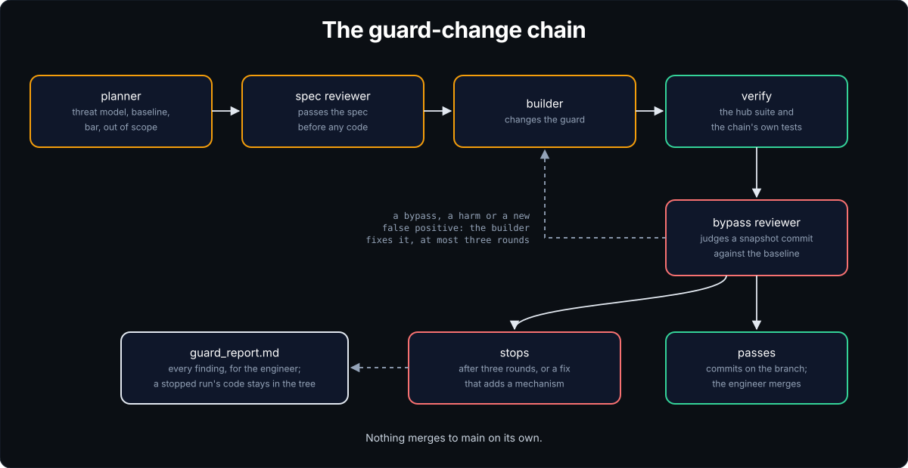

# SSSF in the hub

The hub runs SSSF on itself, so guard changes can go through the guard-change chain (`docs/designs/hub-guard-chain.md`). The install sits on `main`. The installer stamped `adws/`, `justfile`, `.env.sample` and the settings under `adws/adw_sssf_config/` from the skill in `.claude/skills/sssf/`.

## What's here

Most of `adws/` is the install, the same files every repo gets. A few parts exist only in the hub, and `sssf-update` never copies them.

| Part | Hub only | What it is |
|---|---|---|
| `adws/adw_*.py`, `adws/adw_modules/` | no | the AI developer workflows (ADWs) and their modules, stamped from `templates/adws/` ([concepts.md](concepts.md)) |
| `adws/adw_data/prompt_engineering/` | no, except two | each agent's prompts. `guard_spec_reviewer/` and `bypass_reviewer/` belong to the guard-change chain ([Guard changes](#guard-changes)) |
| `adws/adw_data/harness_engineering/` | no | pi extensions: `subagents.ts` and its helper `themeMap.ts` |
| `adws/adw_guard_change.py` | yes | the ADW every change to guard code goes through ([Guard changes](#guard-changes)) |
| `adws/check_projects.py` | yes | checks each project after an update ([Check the projects' updates](#check-the-projects-updates)) |
| `adws/levers.py` | yes | the four levers, week by week ([The four levers](#the-four-levers)) |
| `adws/phase_times.py` | yes | each chain's usual phase times, and the runs well past them ([Phase times](#phase-times)) |
| `adws/features.py` | yes | what each feature cost ([What each feature cost](#what-each-feature-cost)) |
| `adws/tests/` | yes | tests for the four hub scripts above |
| `local.just` | yes | the hub's recipes, which the justfile loads: `guard-change`, `projects`, `levers`, `features`, `phase-times` and `hub-update` |
| `.claude/agents/bypass-reviewer.md` | yes | a bypass review outside a guard-change run ([Guard changes](#guard-changes)) |
| `.githooks/pre-push` | yes | the secret scan and private-name check on every push ([secret-scan.md](secret-scan.md)) |

## Ground rules

- `adws/` is main's guard. A run changes the skill in `.claude/skills/sssf/`, never `adws/`, and `adws/` is a protected path. The two meet only when an update lands on `main`.
- Runs cut their own branch from `main` and commit locally. The engineer runs every push. A `forbid` rule with `on_match: refuse` refuses `git push` and the `gh` commands that write to GitHub, and the pre-push hook refuses a push while `SSSF_ADW_ID` is set.
- Agents bill to the Claude subscription through its sign-in. `.env` holds no API key.

## Install

```bash
uv run .claude/skills/sssf/scripts/install.py --coding-agent claude_code
```

The Claude Code roster as shipped puts planner, reviewer, standards_reviewer and spec_reviewer on Opus, builder and ticket_builder on the default, Sonnet, and scout and documenter on Haiku.

`protected_files` adds the hub's own rules and records to the shipped list: `.claude/agents/`, `CLAUDE.md`, `CLAUDE.local.md`, `docs/projects.md` and `adws/tests/`.

`repo.yaml` sets `max_worktree_runs: 1`, because the suite's process-kill tests are timing-sensitive. It sets `worktree_setup: []`, because the suite needs only `uv`.

Check the billing as in [install.md](guide/install.md#4-check-that-it-works).

## Quality

`adws/adw_modules/quality.py` has two blocks. The hub has no lint, format, typecheck or build step.

| Block | argv |
|---|---|
| test | `uv run --directory .claude/skills/sssf --with pytest --with pydantic --with pyyaml --with python-dotenv --with rich pytest tests -q -p no:cacheprovider` |
| chain_test | `uv run --with pytest --with pydantic --with pyyaml --with python-dotenv --with rich pytest adws/tests -q -p no:cacheprovider` |

The skill's suite takes about five and a half minutes, and `chain_test` a few seconds. Run cea6fe8d's verify, on 2026-11-10, took 320 and 2.4 seconds. The hub has no CI, so these two blocks are the whole check.

## Run and watch

`just simple-sdlc path/to/task.md` runs the usual ADW, `adw_simple_sdlc`. `just sessions`, `just phases <adw_id>` and `just obs` read the trace.

## Guard changes

Guard code fails quietly. A bug passes every test and lets an agent through. The chain exists because that happened twice. A rule change passed its tests and let `cat <<EOF | bash` past every agent rule, and two project sessions caught it only after the update went out. Then the git-directory guard took 17 bypass-review rounds by hand, each finding a way around the newest fix ([the post-mortem](postmortems/git-dir-guard.md)). The chain runs that review on every change, judges each finding against a baseline and a bar the spec sets, and stops after three rounds instead of seventeen. [concepts.md](concepts.md#guards) says what guard code is for.

<p align="center">
  
</p>

Run a change to guard code through `adws/adw_guard_change.py`, on its own branch cut from `main`:

```bash
git checkout -b guard-<slug> main
just guard-change specs/tasks/<task>.md      # uv run adws/adw_guard_change.py ...
```

The run goes through these steps:

1. The planner writes a spec with a threat model, a baseline, a bar and what's out of scope.
2. `guard_spec_reviewer` passes the spec before any code.
3. The builder changes the guard, and verify runs the hub suite and the chain's own tests.
4. `bypass_reviewer` judges a snapshot commit of the tree against the baseline, for at most three rounds.

Bypasses, harms and new false positives block. `--allow-false-positives` turns off the last for one run. `--base` names the baseline ref, `main` by default. `--worktree` runs on branch `sssf/<adw_id>` in its own worktree instead of the current branch. A fix that adds module-level state or a `global` to a guard module stops the run, and so does the reviewer's `adds_mechanism`.

Without `--worktree`, the run holds the hub's checkout on its branch until it ends, and `sssf-update` in every project refuses while the skill source has commits not on `main`. If a rollout may overlap the run, use `--worktree`.

Some findings need an agent on the host, in a run with `--sandbox none`, to write a file outside the repo that the host later runs. Such a finding is a local-mode limit, not a bypass. Decision 14 in [openshell-sandbox.md](designs/openshell-sandbox.md#decided-by-the-engineer) says why.

Every finding lands in `context_handoff/guard_report.md`. A run that passes commits the code. A run that stops leaves the code in the tree for the engineer. Nothing merges to `main` on its own.

The chain, its prompts, its two roster agents and its tests are hub-only: `adws/adw_guard_change.py`, `adws/adw_data/prompt_engineering/` under `bypass_reviewer/` and `guard_spec_reviewer/`, and `adws/tests/`. An update never touches them. `max_run_cost` is $20 here, since a run can make three Opus bypass reviews at up to $5 each.

## Update SSSF

`just sssf-update` refuses here, because the skill source is this repo's own copy. The hub updates from the install clone instead, which the next section describes. After a skill change merges to `main`, move the clone forward, then update on a short branch:

```bash
just hub-update
```

`just hub-update` runs `git -C ~/github/sssf-install pull --ff-only`, then `SSSF_SOURCE=~/github/sssf-install/.claude/skills/sssf uv run .claude/skills/sssf/scripts/install.py --update`. To use another clone, name it in `SSSF_INSTALL_CLONE` in `.env`.

Then run `just take` or `just keep` on each flagged file, as in the install cookbook, and fast-forward `main`. The stamp records the clone's `skill` commit, which the agentsh install checks.

## The install clone

`~/github/sssf-install` is a `git clone --no-local` of this repo, with its own `.git`. A plain local clone would share object files with the hub, which agents may write, and git doesn't check an object's hash when it reads it, so an agent's object would run as `agentsh_install.py` from the clone. No run uses it, so no agent can edit it, under the base guards alone or under agentsh. Every agentsh install, the hub's own included, runs from it:

```bash
just agentsh-install ~/github/sssf-install      # from the project, for its policy
```

The recipe runs `uv run --directory ~/github/sssf-install .claude/skills/sssf/scripts/agentsh_install.py --repo <project>`. Name the clone, because the recipe's default, the repo holding `SSSF_SOURCE`, is the hub itself here.

The install refuses to run from inside the project it installs for, so the hub can't use its own checkout. The clone isn't a worktree either, because a guard run's agents work in worktrees under this repo and share its `.git`.

After each merge, move the clone forward with `git -C ~/github/sssf-install pull --ff-only`. Keep the clone clean, because the install refuses a dirty source.

## The dashboard

Run the all-projects dashboard from here:

```bash
just obs-all
```

The dashboard reads the machine-wide registry, so it shows every project from any repo. Run from here, it's built from the skill source, always the newest, and nothing runs in a project's repo. It only reads their traces. `just obs` in a project still shows that one repo.

## Check the projects' updates

After the hub asks each project session to update, check their reports:

```bash
just projects      # uv run adws/check_projects.py
```

The script reads every project in the install registry except the hub. It fails a project in any of these cases:

- its `stamp.json` names a different skill commit;
- its last stamp commit isn't "Update SSSF to skill <h>";
- its tree isn't clean;
- its committed `.claude/skills/sssf` differs from this repo's at that commit;
- no `adw_quality` run has passed since the update.

A stray or leftover skill file shows as `extra`. The script only reads git and each trace, so it's safe on a repo whose session owns it.

- `--skill <h>` expects an older commit.
- `--repo <name>` checks one repo.
- `--listed` leaves out the repos `.git/sssf-private-names` lists and says only how many. Its output is safe to paste into this public repo.
- `--json` prints one object for the factory page, with the same exit code. Each repo adds `stamped`, `behind` and `at_stamp`, so a repo that is only behind the hub can be told from one whose skill copy was changed.

The script and its tests are hub-only, like the guard-change chain.

## The four levers

`just levers` (`uv run adws/levers.py`) prints one row per ISO week, across every repo in the install registry. It counts the levers `docs/research/thinking-in-threads.md` describes:

- runs, and the most at once;
- minutes and agent tool calls per agent run;
- agents per run;
- touches, and agent tool calls per touch.

A touch is an agent run's engineer phase or a merge commit, so it measures the sessions' launches as much as the engineer's attention. The script's docstring says what each column counts. Three columns show yield. Accepted is the runs whose status is `success`, $/accepted is the week's spend per accepted run, and longest is the longest agent run.

- `--weeks N` sets the window.
- `--by-repo` adds a table per repo.
- `--listed` leaves out private repos, as `check_projects.py` does.
- `--real` leaves out quality-only runs and the repos `.git/sssf-test-beds` names, one per line. The file lives in `.git`, so no name is committed.

The script only reads, and it's hub-only.

## What each feature cost

`just features` (`uv run adws/features.py`) joins each repo's agent runs to the commits that reached its main line. The main line is the current branch, unless `--branch REPO=BRANCH` names another.

- Runs that landed at one point are one feature, with its cost, run count and lead time. The script matches a rebased commit by patch-id, then by subject.
- Runs that never landed are pending while a branch still holds them, and gone otherwise.
- The script counts runs with no commits apart.

`--repo NAME` picks one repo and can repeat. `--weeks`, `--listed` and `--real` work as in `levers.py`. `levers.py --by-type` gives one row per ADW. Both scripts only read, and both are hub-only.

## Phase times

`just phase-times` (`uv run adws/phase_times.py`) reads every repo's trace and prints, per chain, the median and 90th percentile of each phase, of the whole run and of its cost, from the chain's last 50 successful runs. Numbered phases share a row, so `bypass_review_N` covers every round. Phases under a minute are left out unless you pass `--all`.

It then lists everything in the last 14 days that took more than twice its 90th percentile: a phase, a phase still running, a whole run, or a run's cost. A chain needs 10 successful runs before anything is judged, and nothing under a minute counts as slow. `--days`, `--factor`, `--history` and `--min-runs` change those numbers, and `--listed` works as in `levers.py`. `--json` prints the rows in seconds and each slow item with its ratio to the p90, for the factory page.

A slow phase isn't a failure: `SilentStop` already stops an agent that writes nothing for 15 minutes. This finds the ones that kept writing and ran long. It also lists phases still marked running in a run that ended, which a restart left open before the tracer closed them at `session_finish` (2026-11-11).

## If the hub session goes to the background

On 2026-11-02 the hub session became a background job without the engineer meaning it to. The next day, `claude --continue` refused to open it, with "Your most recent conversation moved to a background session ... registered from another machine or container". `claude --resume 8236c0c7-361e-485d-966a-a6f30eaa813f` brought it back.

The likely cause is pressing the left arrow on an empty prompt, for example twice after clearing the line with Backspace. Claude Code's agent view takes that as "background this session". Nothing records which key it was.

To get the session back, use any one of these:

- `claude --resume <session id>`
- `claude attach <id>`
- `claude agents`, then Enter on its row

Don't use `--fork-session`. It makes a second hub session with the same history, which puts two writers in one repo.

The failed `--continue` left a stale socket in `/run/user/1000/cc-socks/` with no process behind it, and the restarted session registered as "super-simple-software-factory (2)". The engineer removed the socket. Replies from project sessions still arrived.

If it happens again, turn off `leftArrowOpensAgents` in `/config`. On 2026-11-03 the engineer left it on for now. Claude Code stores the setting in `~/.claude.json`, so change it through `/config`, not by hand.
